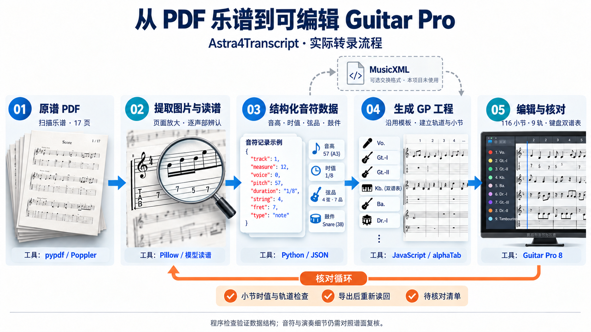

# Astra4Transcript

A Guitar Pro transcription project for “Izonshou” (依存症), containing an editable full score, transcription data and supporting scripts, and previews of the source score and transcription.

[中文](README.md) · [English](README.en.md)

## Work information

| Item | Information |
| --- | --- |
| Song | 依存症 / Izonshou — I Am an Addict |
| Artist | 椎名林檎 / Sheena Ringo |
| Lyrics and composition | Sheena Ringo |
| Original arrangement | Seiji Kameda and Sheena Ringo |
| Album | 勝訴ストリップ / Shōso Strip, track 13 |
| Album release date | March 31, 2000 |

Sources: [Universal Music official album page](https://www.universal-music.co.jp/sheena-ringo/products/toct-24321/) and [Uta-Net song credits](https://www.uta-net.com/song/12963/).

This is an unofficial transcription. Rights to the original composition and published sheet music belong to their respective rights holders.

## Video links

1. [Live — 下剋上エクスタシー (Gekokujou Ecstasy)](https://www.bilibili.com/video/BV1CPZpYQESX/)
2. [Music video](https://www.bilibili.com/video/BV1bA411e71o)

## Transcription workflow

The actual workflow is: PDF → page images and score reading → structured Python / JSON records → JavaScript / alphaTab export → Guitar Pro editing and review. MusicXML is an optional interchange format and was not used in this project.

This is an AI-generated process illustration; its notation and interface elements explain the steps. Refer to the project and previews for the actual transcription. Programmatic checks validate data structure; notes and performance details still require comparison with the source score.

## Guitar Pro project

[Download the score: source structure · review v1](scores/依存症_全曲_原谱结构_核对v1.gp)

Guitar Pro 8 is recommended.

The project contains **116 measures, 9 tracks and 10 staves**. Guitar and bass parts retain tablature, and the keyboard uses two staves.

| Track | Content |
| --- | --- |
| Vo. | Vocal melody |
| Gt.-I | First guitar part |
| Gt.-II | Second guitar part |
| Gt.-III | Additional guitar part |
| Kb. | Two-staff keyboard, E.P. / Pf. |
| Ba. | Bass |
| Dr.-I | Main drum part |
| Dr.-II | Additional drum part |
| Tambourine | Tambourine |

The project retains the source score's Intro, sections A–G, D.S. / Coda navigation, conditional playing instructions and Cut Out marking.

## Source score previews

[Download the source score PDF: 依存症-总谱.pdf](sources/依存症-总谱.pdf)

The source previews are rendered directly from the PDF, with two complete pages side by side and the original layout and page boundaries preserved.

### PDF pages 2–3

### PDF pages 4–5

## Transcription previews

The transcription previews are generated from the review-v1 project using alphaTab. Each preview page contains eight measures, and each image contains two pages.

Preview pagination is independent, and lengthy review annotations are shortened. Page numbers may differ from Guitar Pro's native print pagination. Refer to the `.gp` project for the complete content.

### Preview pages 1–2: measures 1–16

### Preview pages 3–4: measures 17–32

## Repository structure

| Directory or file | Content |
| --- | --- |
| `scores/` | Currently published Guitar Pro project |
| `sources/` | Source score PDF used for the transcription |
| `assets/` | Source score screenshots and GP score previews |
| `project/` | Initial transcription data, Python checking scripts, JavaScript exporter and four-measure template |
| `docs/initial-transcription/` | Initial transcription notes, review checklist and internal validation report |
| `docs/release-manifest.json` | Release-file provenance, checksums and validation scope |

`project/` records the initial production process. Review v1 is maintained separately and cannot be reproduced directly by rerunning the initial scripts. See the [project documentation](project/README.md) for dependencies and execution instructions.

## Review status

The current release is **review v1**. A complete review of all notes and performance details has not yet been completed. Remaining areas include:

- Bend amounts, durations and release shapes.
- Grace notes, harmonics and related performance effects.
- Entry, ending and alignment of some additional parts with the main parts.

The initial internal checks primarily verify measure duration, track completeness and consistency before and after export. They do not constitute a note-by-note review. The initial reports do not certify acceptance of review v1.

## Issue reports

Report issues through [Issues](https://github.com/SheenaAsuka/Astra4Transcript/issues). Include the version, source measure number, track name and specific discrepancy. For notation-reading issues, attach a screenshot of the relevant passage if available.
