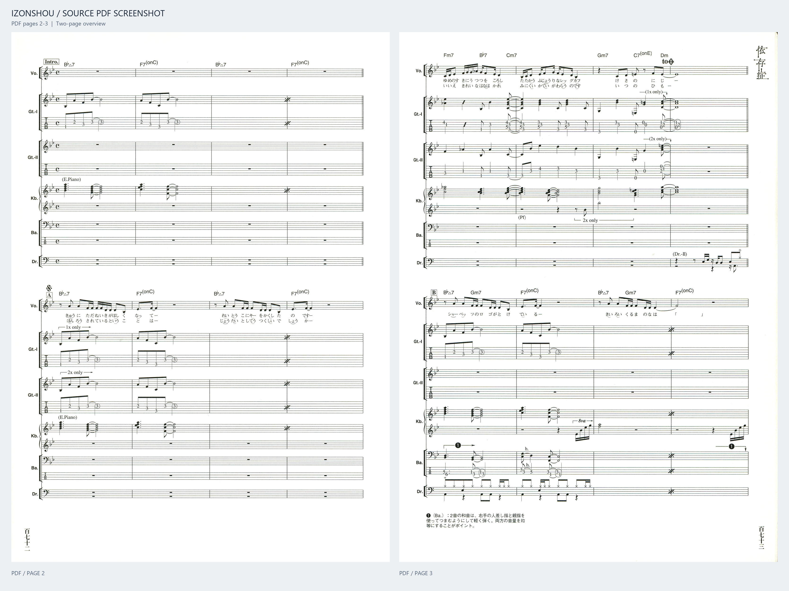
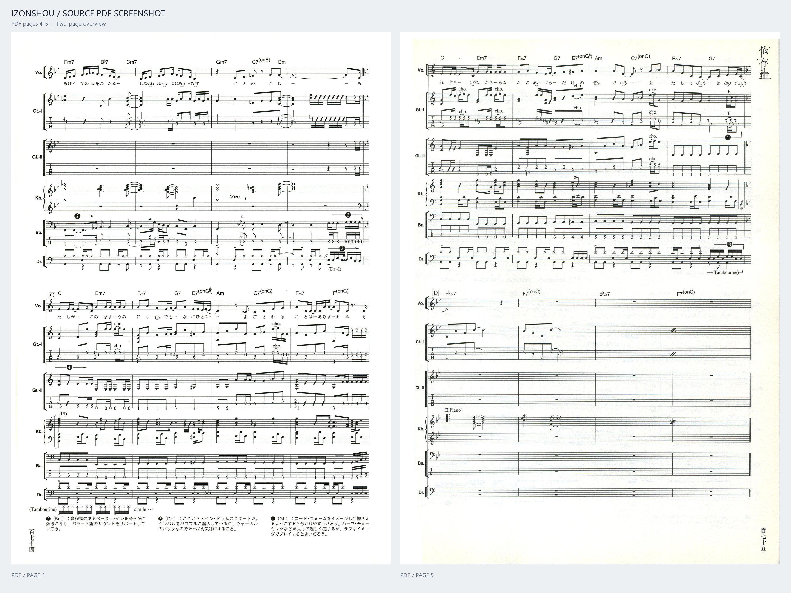
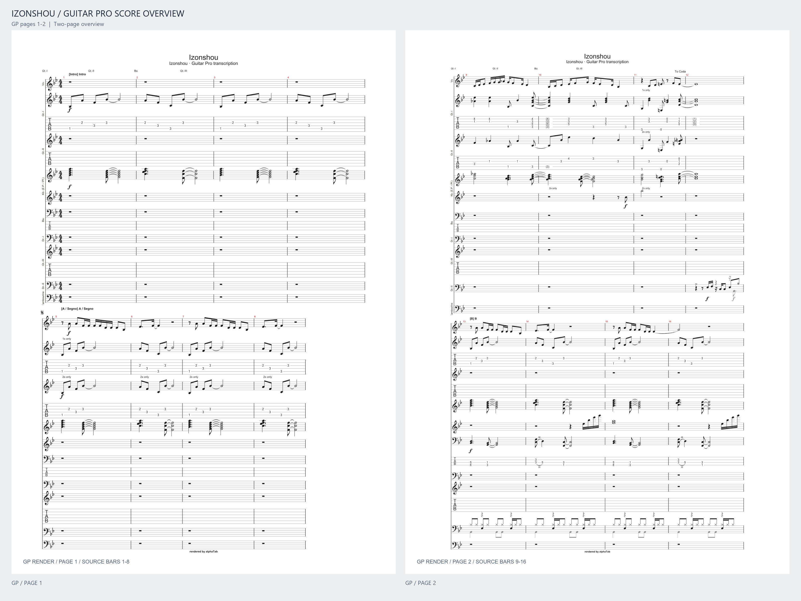
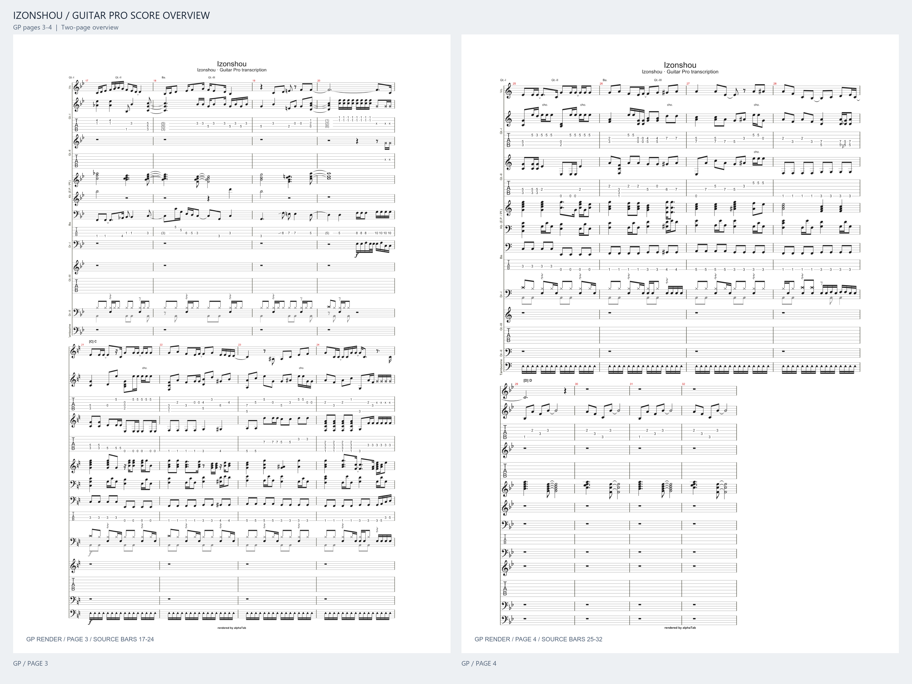

# Astra4Transcript

《依存症》（Izonshou）的 Guitar Pro 总谱转录项目，包含可编辑工程、转录数据与辅助脚本，以及原谱和转录结果的预览图。

[中文](README.md) · [English](README.en.md)

## 作品信息

| 项目 | 信息 |
| --- | --- |
| 曲名 | 依存症 / Izonshou — I Am an Addict |
| 艺人 | 椎名林檎 / Sheena Ringo |
| 作词、作曲 | 椎名林檎 |
| 原曲编曲 | 亀田誠治、椎名林檎 |
| 所属专辑 | 《勝訴ストリップ》/ Shōso Strip，第 13 曲 |
| 专辑发行日期 | 2000 年 3 月 31 日 |

信息来源：[Universal Music 官方专辑页](https://www.universal-music.co.jp/sheena-ringo/products/toct-24321/)、[歌ネット作品署名](https://www.uta-net.com/song/12963/)。

本项目为非官方转录。原曲及原版乐谱的相关权利归各自权利人所有。

## 视频链接

1. [Live（下剋上エクスタシー）版](https://www.bilibili.com/video/BV1CPZpYQESX/)
2. [MV版](https://www.bilibili.com/video/BV1bA411e71o)

## Guitar Pro 工程

[下载总谱：原谱结构 · 核对 v1](scores/依存症_全曲_原谱结构_核对v1.gp)

建议使用 Guitar Pro 8 打开。

工程包含 **116 小节、9 条轨道、10 个谱表**。吉他和贝斯保留 TAB，键盘使用双谱表。

| 轨道 | 内容 |
| --- | --- |
| Vo. | 主唱旋律 |
| Gt.-I | 吉他第一声部 |
| Gt.-II | 吉他第二声部 |
| Gt.-III | 吉他补充声部 |
| Kb. | 键盘双谱表，E.P. / Pf. |
| Ba. | 贝斯 |
| Dr.-I | 主鼓声部 |
| Dr.-II | 补充鼓声部 |
| Tambourine | 铃鼓 |

工程保留原谱的 Intro、A–G 段落、D.S. / Coda 跳转、条件演奏提示及 Cut Out 标记。

## 原谱预览

以下图片直接渲染自原谱 PDF，每张并排显示两页，保留完整页边界和原有排版。

### PDF 第 2–3 页

### PDF 第 4–5 页

## 转录结果预览

以下图片使用 alphaTab 从“核对 v1”工程生成，每页展示 8 小节，每张图包含两页。

预览采用独立分页，并简化了较长的核对注释；页码可能与 Guitar Pro 的原生打印分页不同。完整内容以 `.gp` 工程为准。

### 预览第 1–2 页：小节 1–16

### 预览第 3–4 页：小节 17–32

## 仓库结构

| 目录或文件 | 内容 |
| --- | --- |
| `scores/` | 当前发布的 Guitar Pro 工程 |
| `assets/` | 原谱截图与 GP 总谱预览 |
| `project/` | 初版转录数据、Python 检查脚本、JavaScript 导出脚本及四小节模板 |
| `docs/initial-transcription/` | 初版转录说明、待核对清单与内部检查报告 |
| `docs/release-manifest.json` | 发布文件来源、校验值及检查范围 |

`project/` 记录初版制作过程。“核对 v1”单独维护，重新运行初版脚本不会直接复现该版本。依赖和运行方式见 [工程说明](project/README.md)。

## 核对状态

当前发布版本为 **核对 v1**，尚未完成全部音符和演奏细节的复核。仍需关注的内容包括：

- 推弦的幅度、持续时间及回落方式。
- 装饰音、泛音及相关演奏效果。
- 部分补充声部的进入、结束及与主声部的对齐。

初版内部检查主要验证小节时值、轨道完整性和导出前后的数据一致性，不等同于逐音校对。初版报告不作为核对 v1 已完成验收的依据。

## 问题反馈

可通过 [Issues](https://github.com/SheenaAsuka/Astra4Transcript/issues) 提交问题。请注明版本、原谱小节号、轨道名称及具体差异；涉及谱面辨认时，可附对应位置的截图。
